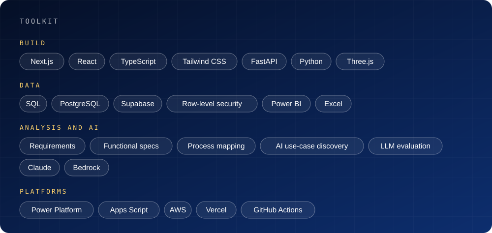
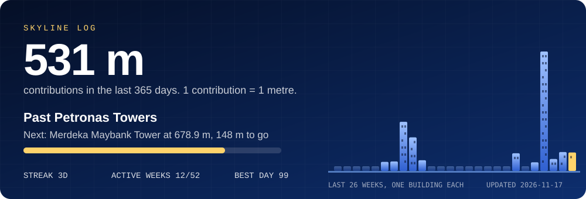

  

  
  
  

## Signal

I'm **Muhammad Alif Najmi (Alif)**, a Business Analyst at [axrail.ai](https://axrail.ai) and a Computer Science graduate of Universiti Teknologi PETRONAS, based in Kuala Lumpur. By day I turn business processes into clear requirements for data and AI solutions. After hours I build the products I specify: apps people in Malaysia actually use.

## Selected work

| Project | What it does | Stack |
|---|---|---|
| [**SMK Subang Data Dashboard**](https://github.com/7YMERA/dashboard-smksubang-portfolio) | One live data hub used daily by about 150 teachers. Totals in public, names behind login. | Next.js, Express, Supabase |
| [**TaskMatch**](https://github.com/7YMERA/taskmatch-v2) | Matches tasks to the right person with a fit score out of 100 that explains itself. | Next.js, FastAPI, Supabase |
| [**MyLokalEvent 2.0**](https://github.com/7YMERA/mylokalevent-v2) | Find, post and promote local events across Malaysia, in BM and EN. | Next.js, Supabase, Stripe |
| [**KakiLima**](https://github.com/7YMERA/kakilima) | Safer streets for everyone, in four languages and accessible first. | Next.js, Tailwind v4 |
| [**JumaatFinder**](https://github.com/7YMERA/jumaat-finder-app) | The nearest masjid or surau for Friday prayers, and when to leave. | Python, Leaflet |
| [**Join Atlas**](https://github.com/7YMERA/database-project-uplift) | Pick tables. It finds the join path, writes the SQL and runs it in your browser. | SQL, sql.js |
| [**This portfolio**](https://github.com/7YMERA/7ymera.github.io) | A scroll-driven 3D flight over Kuala Lumpur. Plain JavaScript, no framework. | WebGL, Three.js |

## Currently in orbit

- Growing **TaskMatch** from a final year project into a product teams can adopt.
- Taking **MyLokalEvent 2.0** from MVP towards real organisers and real payments.
- Learning **Mandarin**, one weekly class at a time.
- Rating and comparing LLM responses against detailed rubrics, as a freelance evaluator.

## Toolkit

  

## Skyline log

  

Redrawn every day by a small GitHub Action. One contribution is one metre, and the card compares the total with Menara KL, The Exchange 106, the Petronas Towers and Merdeka Maybank Tower.

## Say hello

Got a process that needs untangling, or an idea that needs building? The fastest way is through my [portfolio](https://7ymera.github.io) or [LinkedIn](https://www.linkedin.com/in/muhammad-alif-najmi-md-hisamudin).
